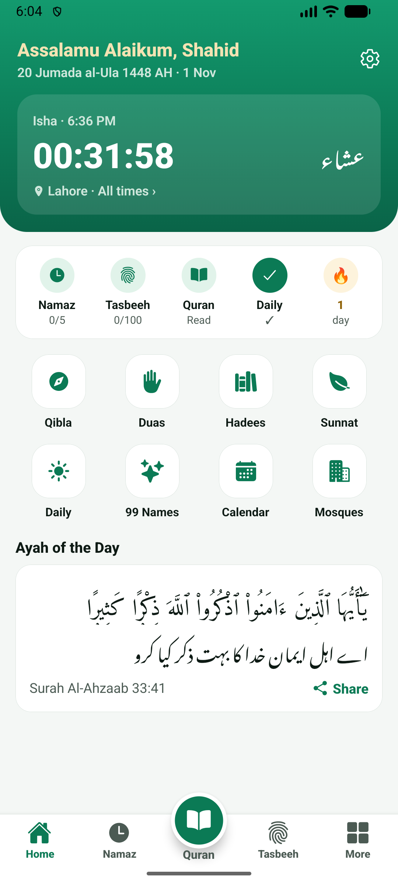
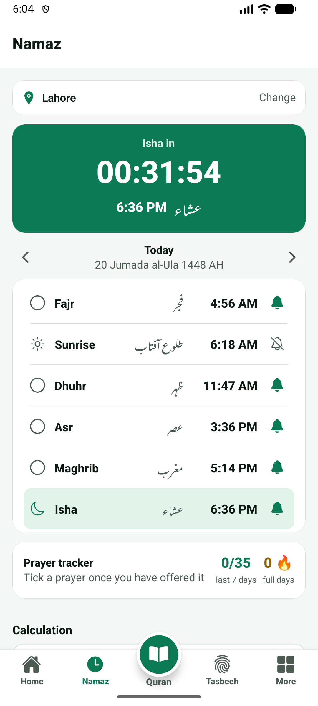
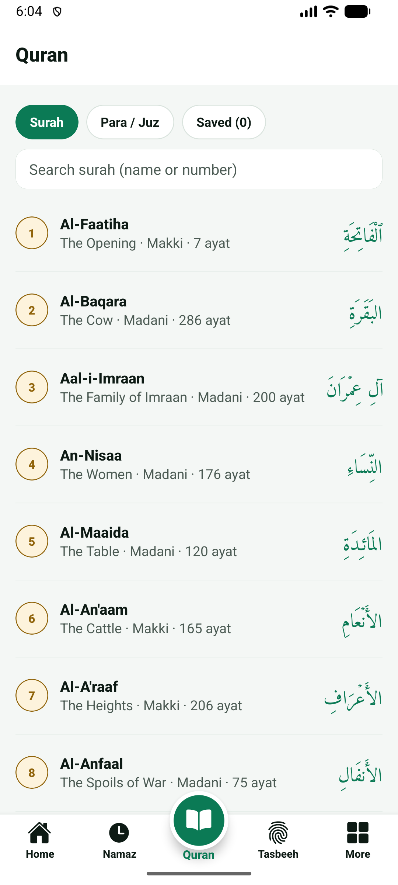
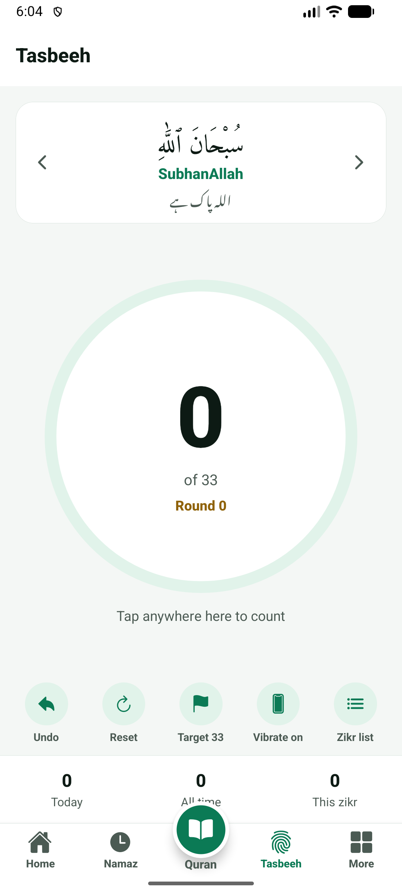

# Islam 365 — Prayer Times, Quran, Tasbeeh & Qibla (Free, No Ads)

**Islam 365** is a free, ad-free Islamic app for Android.

🌐 Website & blog: https://islam365-app.vercel.app

## Features
- 🕌 **Prayer times** for your exact location, auto calculation method (Karachi, Umm al-Qura, ISNA, MWL, Dubai, Diyanet) and Hanafi / Shafi'i Asr
- 🔔 **Azan reminders**: before prayer, at prayer time and before the time ends; Jumu'ah Surah Al-Kahf reminder
- 📖 **Quran Majeed** offline with Urdu (Jalandhry) and English translation, 5 more languages, Alafasy recitation
- 📿 **Digital tasbeeh counter** with vibration, targets 33 / 99 / 100, rounds and custom zikr
- 📚 **Hadith**: Bukhari, Muslim, Abu Dawud, Tirmidhi, Nasai, Ibn Majah, Muwatta; hadith of the day; everyday sunnahs
- 🤲 **Morning & evening azkar** and duas from Hisn al-Muslim
- 🧭 **Qibla compass**, 🌙 **Hijri calendar**, Ramadan sehri & iftar times, 💰 **Zakat calculator**, 99 Names of Allah, mosques near me
- No ads · No sign-up · Your data stays on your phone

## Screenshots

   

## Guides (English)
- [Tahajjud Prayer: Best Time, How to Pray and How to Wake Up for It](https://islam365-app.vercel.app/blog/tahajjud-prayer-time-how-to-pray/)
- [Salat al-Istikhara: How to Pray and the Dua for Guidance](https://islam365-app.vercel.app/blog/istikhara-dua-how-to-pray/)
- [The 12 Islamic Months: Names, Meanings and Important Dates in the Hijri Calendar](https://islam365-app.vercel.app/blog/islamic-months-hijri-calendar-names-meaning/)
- [Dua for Travelling (Safar ki Dua) and Sunnahs of a Journey](https://islam365-app.vercel.app/blog/safar-ki-dua-travel-dua/)
- [The Last Two Ayat of Surah Al-Baqarah: Meaning and Why to Read Them Every Night](https://islam365-app.vercel.app/blog/surah-baqarah-last-two-ayat-amanar-rasul/)
- [10 Rabbana Duas from the Quran with Meaning (Easy to Memorise)](https://islam365-app.vercel.app/blog/rabbana-duas-from-the-quran/)
- [Duas for Anxiety, Stress and Worry from the Quran and Sunnah](https://islam365-app.vercel.app/blog/dua-for-anxiety-stress-worry/)
- [Sunnah Fasts: Mondays, Thursdays and the White Days (Ayyam al-Beed)](https://islam365-app.vercel.app/blog/fasting-monday-thursday-white-days/)
- [Surah Al-Mulk: Why the Prophet ﷺ Recited It Every Night](https://islam365-app.vercel.app/blog/surah-mulk-benefits-before-sleep/)
- [9 Times When Dua Is Most Likely to Be Accepted (with Hadith References)](https://islam365-app.vercel.app/blog/best-times-for-dua-to-be-accepted/)
- [10 Short Daily Duas to Teach Your Children](https://islam365-app.vercel.app/blog/short-duas-for-kids-children/)
- [Witr Prayer: How Many Rakat, When to Pray and Dua Qunoot](https://islam365-app.vercel.app/blog/witr-prayer-how-to-pray-dua-qunoot/)
- [How to Perform Umrah: A Simple Step-by-Step Guide](https://islam365-app.vercel.app/blog/how-to-perform-umrah-step-by-step/)
- [The Four Stories of Surah Al-Kahf and Their Lessons for Today](https://islam365-app.vercel.app/blog/surah-kahf-four-stories-lessons/)
- [How to Pray Salah Step by Step: A Beginner's Guide (Hanafi)](https://islam365-app.vercel.app/blog/how-to-pray-salah-step-by-step/)
- [Sunnahs of Eid: What to Do on Eid al-Fitr and Eid al-Adha](https://islam365-app.vercel.app/blog/eid-sunnahs-eid-ul-fitr-eid-ul-adha/)
- [Ayatul Kursi in English: Transliteration, Meaning and Benefits](https://islam365-app.vercel.app/blog/ayatul-kursi-english-meaning-benefits/)
- [How to Memorise the Quran as an Adult: 8 Practical Tips](https://islam365-app.vercel.app/blog/how-to-memorize-quran-tips-for-adults/)
- [Choosing an Islamic App: 7 Things to Check Before You Install](https://islam365-app.vercel.app/blog/what-to-look-for-in-an-islamic-app/)
- [Zakat al-Fitr (Fitrana): Who Pays, How Much and When](https://islam365-app.vercel.app/blog/zakat-al-fitr-fitrana-guide/)
- [Islam 365: A Free, Ad-Free Islamic App for Prayer Times, Quran and Tasbeeh](https://islam365-app.vercel.app/blog/free-ad-free-islamic-app-prayer-times-quran-tasbeeh/)
- [How to Find the Qibla Direction on Your Phone (Step by Step)](https://islam365-app.vercel.app/blog/how-to-find-qibla-direction-on-your-phone/)
- [Why Prayer Times Differ Between Apps: Calculation Methods and Hanafi vs Shafi Asr](https://islam365-app.vercel.app/blog/prayer-time-calculation-methods-hanafi-shafi-asr/)
- [Digital Tasbeeh Counter: Zikr After Namaz and How to Build a Daily Habit](https://islam365-app.vercel.app/blog/digital-tasbeeh-counter-guide-zikr-after-namaz/)
- [How to Calculate Zakat: Nisab in Gold and Silver, 2.5% Rule and a Simple Calculator](https://islam365-app.vercel.app/blog/zakat-calculator-nisab-gold-silver-guide/)
- [99 Names of Allah (Asma ul Husna): Meaning and How to Learn Them](https://islam365-app.vercel.app/blog/99-names-of-allah-asma-ul-husna-meaning/)
- [Ramadan 2027 Preparation: A Simple Checklist to Start Now](https://islam365-app.vercel.app/blog/ramadan-2027-preparation-checklist/)
- [Read the Quran with Urdu Translation Offline on Your Phone](https://islam365-app.vercel.app/blog/quran-with-urdu-translation-offline-app/)

## رہنمائی (اردو)
- [اذان کے بعد کی دعا: عربی متن، اردو ترجمہ اور فضیلت](https://islam365-app.vercel.app/blog/azan-ke-baad-ki-dua/)
- [سونے کی سنتیں اور دعائیں: رات کو سونے سے پہلے کے مسنون اعمال](https://islam365-app.vercel.app/blog/sone-ki-sunnatein-aur-duain/)
- [وضو کا مسنون طریقہ: فرائض، سنتیں اور وضو کے بعد کی دعا](https://islam365-app.vercel.app/blog/wuzu-ka-tarika-faraiz-sunnatein/)
- [والدین کے لیے قرآنی دعائیں: رَبِّ ارْحَمْهُمَا اور دیگر](https://islam365-app.vercel.app/blog/walidain-ke-liye-dua/)
- [درود ابراہیمی: مکمل عربی متن، اردو ترجمہ اور درود شریف کی فضیلت](https://islam365-app.vercel.app/blog/durood-ibrahimi-fazilat/)
- [لیلۃ القدر کی دعا اور رمضان کے آخری عشرے کے اعمال](https://islam365-app.vercel.app/blog/laylatul-qadr-ki-dua-aakhri-ashra/)
- [فرض نماز کے بعد کے مسنون اذکار](https://islam365-app.vercel.app/blog/namaz-ke-baad-ke-azkar/)
- [کھانے سے پہلے اور بعد کی دعائیں اور کھانے کی سنتیں](https://islam365-app.vercel.app/blog/khane-ki-duain-aur-adab/)
- [گھر سے نکلنے اور گھر میں داخل ہونے کی دعا](https://islam365-app.vercel.app/blog/ghar-se-nikalne-aur-dakhil-hone-ki-dua/)
- [بیماری میں شفا کی مسنون دعائیں اور مریض کی عیادت کے آداب](https://islam365-app.vercel.app/blog/bimari-mein-shifa-ki-dua/)
- [استغفار کی فضیلت: روزانہ سو بار استغفار اور اس کے فائدے](https://islam365-app.vercel.app/blog/istighfar-ki-fazilat-astaghfirullah/)
- [نماز جنازہ کا طریقہ اور جنازے کی دعا (حنفی)](https://islam365-app.vercel.app/blog/namaz-e-janaza-ka-tarika-dua/)
- [قضا نماز کا طریقہ: قضا نمازیں کیسے ادا کریں (حنفی)](https://islam365-app.vercel.app/blog/qaza-namaz-ka-tarika/)
- [نماز کا مکمل طریقہ (حنفی): تکبیر سے سلام تک](https://islam365-app.vercel.app/blog/namaz-ka-tarika/)
- [جمعہ کی نماز کی رکعتیں اور طریقہ (حنفی)](https://islam365-app.vercel.app/blog/jumma-ki-namaz-ki-rakat/)
- [بڑی عمر میں قرآن حفظ کرنے کا آسان طریقہ: ۸ عملی مشورے](https://islam365-app.vercel.app/blog/quran-hifz-karne-ka-asan-tarika/)
- [آیت الکرسی: عربی متن، اردو ترجمہ اور فضیلت](https://islam365-app.vercel.app/blog/ayatul-kursi-fazilat-tarjuma/)
- [روزہ کھولنے کی دعا اور سحری و افطار کی سنتیں](https://islam365-app.vercel.app/blog/sehri-iftar-ki-dua-roza/)
- [صبح و شام کے اذکار: چند مسنون دعائیں جو ہر مسلمان کو یاد ہونی چاہئیں](https://islam365-app.vercel.app/blog/subah-shaam-ke-azkar-masnoon-duain/)
- [جمعہ کے دن کی سنتیں: سورۃ الکہف، کثرت سے درود اور قبولیت کی گھڑی](https://islam365-app.vercel.app/blog/jumma-ki-sunnatein-surah-kahf-durood/)
- [موبائل پر نماز کی یاد دہانی کیسے لگائیں (اور نوٹیفکیشن دیر سے آئے تو کیا کریں)](https://islam365-app.vercel.app/blog/namaz-reminder-azan-notification-setup/)

More: [Islam 365 Daily Deen Guides on Blogger](https://islam365-guides.blogspot.com)
